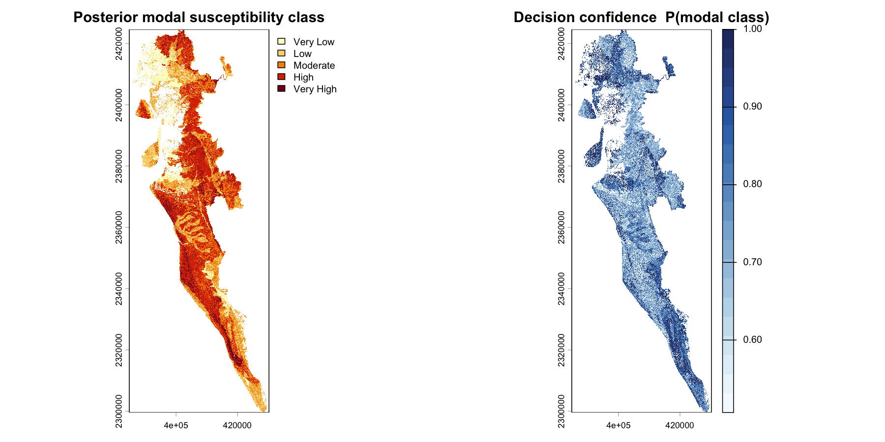
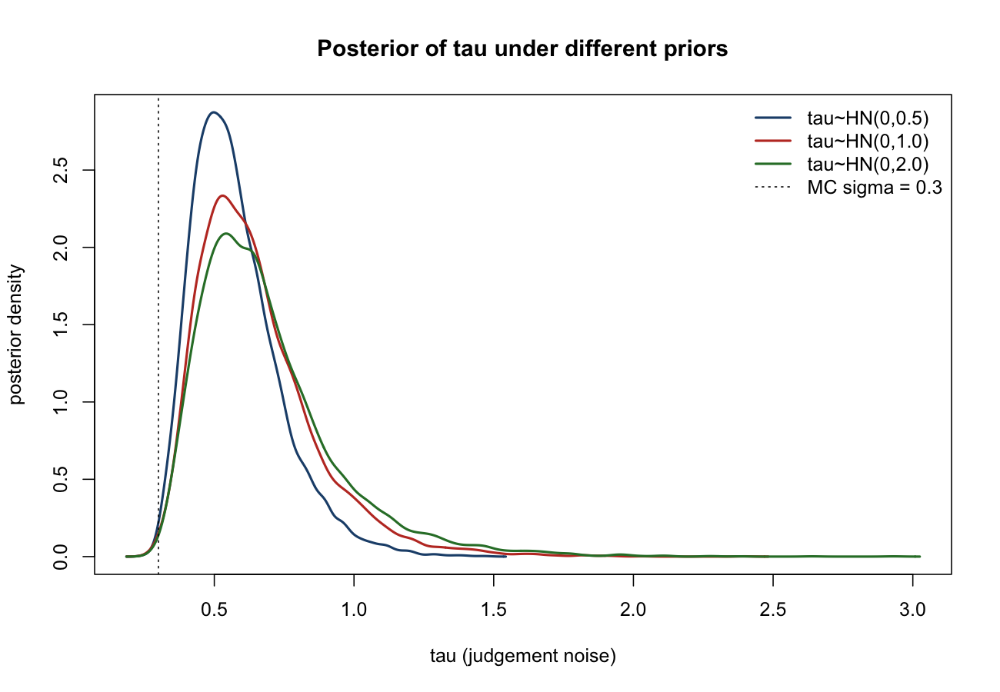

# AHP-based Landslide Susceptibility Mapping with Uncertainty Quantification — Cox's Bazar, Bangladesh

**MSc Data Science dissertation · UCL Department of Statistical Science · 2026**

R · Stan · Bayesian inference · Monte Carlo simulation · SMAA

Landslide susceptibility maps built with the Analytic Hierarchy Process (AHP) rely on expert judgements, which are usually treated as exact. This project asks how far those judgements can be trusted and what that means for the map. Starting from a **published expert AHP weighting**, it estimates the noise in the expert judgements with a Bayesian model and propagates it through the model, producing a **per-pixel decision-confidence layer** instead of a single deterministic map.



## Key results

- **The expert judgements are noisier than usually assumed.** The Bayesian AHP model puts the judgement-noise scale at a posterior median of **0.61**, roughly twice the standard assumption of 0.3 used in the Monte Carlo stage.
- **The map still holds up.** On average, a pixel keeps its susceptibility class under **78% of plausible weightings**.
- **Confidence is reported separately from accuracy.** The per-pixel confidence layer shows where the classification is stable and where it is fragile, which predictive accuracy alone (lift, AUC) cannot show.



## Methods at a glance

1. **One-at-a-time (OAT) sensitivity**: how far each pairwise judgement moves the weights
2. **Monte Carlo perturbation**: joint perturbation of the weights under an assumed noise level
3. **Bayesian AHP in Stan**: infers the judgement-noise scale from the expert's pairwise matrix instead of assuming it (4 chains, 8,000 posterior draws)
4. **Per-pixel SMAA**: stochastic multicriteria acceptability analysis, giving every pixel a confidence value for its class

## Requirements

- **R ≥ 4.1** (developed and run on **R 4.6.0**)
- **Stan** via the `rstan` package (used in the Bayesian stage)
- R packages: `terra`, `sf`, `tmap`, `ggplot2`, `ggspatial`, `cowplot`, `pROC`, `rstan`, `posterior`, `geodata`, and `knitr` (for the R Markdown reports)

Install everything with:

```r
source("setup.R")   # installs any missing packages and prints versions
```

## How to run

The whole pipeline runs end to end from a single driver:

```r
source("scripts/run_all.R")
```

Every stochastic step uses a fixed random seed, so results are reproducible.

## Repository structure

```
R/            analysis scripts (numbered by stage) + R/stan/ models
scripts/      run_all.R (driver)
figures/      selected result figures shown in this README
02_ahp_matrix_construction.Rmd   AHP pairwise-matrix construction notebook
output/       generated tables and figures   (not tracked; regenerated by the pipeline)
data/         input rasters, inventory and boundaries  (NOT included -- see Data availability)
setup.R       one-off package installation / environment check
```

## Pipeline stages

| Stage | Script(s) | Purpose |
|------|-----------|---------|
| Baseline | `00`–`07` | AHP weights, data load, reclassification, weighted overlay, validation (lift, AUC) |
| RQ1 | `08_oat_sensitivity.R` | one-at-a-time sensitivity of the weights |
| RQ2 | `09_monte_carlo.R`, `10_bootstrap.R` | joint weight perturbation + inventory bootstrap |
| RQ3a | `11_bayesian_ahp.R` (+ `R/stan/bayes_ahp.stan`), `11b_prior_sensitivity.R` | Bayesian AHP posterior and judgement-noise scale |
| RQ3b/c | `12_hazard_posterior.R`, `13_smaa.R` | per-pixel susceptibility posterior and SMAA confidence / exceedance |

Robustness and diagnostic scripts (single-factor AUC, spatial block bootstrap, draw-count and tail-ESS checks, class-break robustness) are run individually and are documented in the dissertation appendix.

## Data availability

The input data (five causative-factor rasters, the landslide inventory, and the district / Rohingya-camp boundaries for Cox's Bazar) were **provided by my supervisor** as part of Bayes Ahmed's Cox's Bazar landslide mapping materials. They are **not redistributed in this repository** because their public-sharing terms have not been confirmed. To reproduce the analysis, place the data under `data/` following the paths in `R/02_load_data.R`, or contact the author.

## Licence

The code is released under the MIT Licence (see `LICENSE`). The licence covers the code only, not the input data.

## Citation

Dissertation: *AHP-based Landslide Susceptibility Mapping with Uncertainty Quantification for Cox's Bazar, Bangladesh* (STAT0034, UCL, 2026). The reused expert weighting is from Ahmed (2015), *Landslides* 12(6), 1077–1095.
